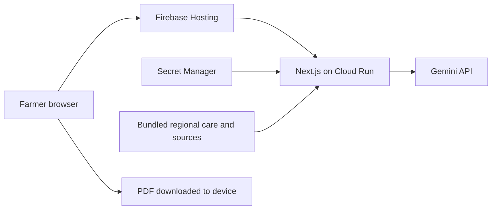

# Crop Health Assistant

A globally accessible coffee leaf screening assistant that helps farmers understand visible leaf problems, explore possible causes and find practical next steps.

**[Open the app](https://coffee-leaf-check.web.app)** · [Reviewer guide](docs/validation/reviewer-guide.md) · [Project scope](docs/scope/scope.md)

Built by **J2D** for the AI Builder Cup, under **Sustainability & Social Impact**. Team members: **Jeremiah Ewande**, team leader and resource coordination, and **Daniel Ridzwan Bin Mohamad**, app development. PNG coffee farmers are our first planned validation group. Agricultural and farmer validation are still pending; we do not claim worldwide agricultural validation.

## What you can do

1. **Add photos.** Upload or take up to two coffee leaf photos. On supported phones, the camera button opens the device camera.
2. **Answer four short questions.** Add the country if known, or choose Not sure or skip it.
3. **Read your result.** See visible changes, possible causes, what to check next and available care steps.
4. **Save your report.** Download an A4 PDF with photos, findings, country, sources and limitations.

English and Tok Pisin are supported. Fixed Tok Pisin wording and AI generated sample reports have completed language review, as confirmed by the team on 16 October 2026. Three later cause wording edits await a fluent check; the rest of that review remains complete. Future generated text is automatically translated and is not individually human reviewed. See the [review scope](docs/content-review/tok-pisin-language-review.md).

## Care coverage and limits

The app is publicly accessible worldwide. Its country selector currently offers **Papua New Guinea, Indonesia, Kenya and Brazil**, plus **Not sure** and **Skip**. These are care coverage locations, not independently validated countries. Country changes do not change the underlying photo evidence.

- Possible causes are tentative AI explanations, not confirmed diagnoses. Photos cannot establish that a plant is healthy or determine every cause.
- Practical care steps are selected from a fixed catalogue with published sources and explicit country applicability. Independent agricultural review of this app remains pending.
- When the country is unknown or matching care is unavailable, the app retains supported observations, explains the gap and recommends local agricultural review.
- Chemical product and spray dose checks are implemented, but **no live chemical products or doses are available**. The verified local registration and label catalogue is currently empty.
- Coffee leaves are the only supported crop and plant part. Other crops, languages and additional regional guidance belong on the roadmap.

The app uses Gemini for screening and explanation. BRACOL images support permitted demonstrations and software evaluation; this project does not train a custom model on the dataset or claim measured disease accuracy.

## How it works



| Component | Purpose |
|---|---|
| Next.js, React and TypeScript | Four step farmer journey and server routes |
| Gemini, official Google SDK | Photo observations, possible causes and generated translation |
| Firebase Hosting | Public address and routing to Cloud Run |
| Cloud Run | Server processing and session checks |
| Secret Manager | Server credentials |
| Zod and sharp | Structured response checks and image validation |
| pdf-lib and Noto Sans | PDF export with headings, photos and page numbers |
| Vitest | Deterministic software checks |

Firestore is not needed for this MVP: cases are processed temporarily and reports are downloaded to the farmer’s device, without saved case history or a permanent database. The organiser permits documenting why Firestore is not applicable. A separate Agent Platform component and ADK are not used; whether either is mandatory remains unresolved. The organiser confirmed the demo must be strictly under three minutes. See [submission requirements](docs/submission/instructions.md).

## Run locally

Use **Node.js 24** and npm with the committed lockfile:

```sh
nvm use
npm ci
npm run dev
```

Open [localhost:3000](http://localhost:3000). Without credentials, local photo preparation works and screening reports its unavailability. No fabricated AI result is substituted. Incomplete reports are available after service or session failures.

### Enable local Gemini access

```sh
cp .env.example .env.local
```

Set these values privately in the ignored `.env.local`:

| Variable | Meaning |
|---|---|
| `GEMINI_API_KEY` | Your Gemini API credential, server only |
| `SESSION_SIGNING_SECRET` | Independent random secret of at least 32 characters |
| `SCREENING_ENABLED` | Defaults to `false`; set to `true` for authorised real screening |
| `GEMINI_MODEL` | Model configured in `.env.example`; requires access and quota |
| `GEMINI_SERVICE_TIER` | `demo` for permitted sample data; `paid` only for an actually paid service |
| `TRUST_PROXY` | Keep `false` locally; enable only behind verified Cloud Run ingress |
| `PUBLIC_APP_ORIGIN` | Exact additional HTTPS origin when Firebase Hosting fronts Cloud Run; empty locally |

Never commit credentials or expose them through browser environment variables. Real screening requires usable Gemini access and may incur charges. Requests use the official SDK, stateless processing with `store: false`, a 45 second deadline and no automatic retry. Google's processing and retention terms still apply.

### Checks

```sh
npm run lint
npm run typecheck
npm test
```

For a production build and standalone server:

```sh
npm run build
npm start
```

`npm run check` runs all checks, including the production build. The build copies static assets and the licensed PDF font into the standalone output.

## Privacy and operating limits

Language preference is stored on the device. Photos, answers, country, results and translations stay in the open tab and disappear on refresh or close. The server processes images in memory, removes image metadata and does not persist case content to a database, disk or logs. Submitted content is sent to Gemini for processing. Downloaded reports remain on the user's device.

- JPEG, PNG or WebP, up to two originals, each at most 10 MiB and 40 megapixels.
- Browser preparation produces JPEG copies up to 1600 pixels on the long edge and 2 MiB each. The server independently validates images and enforces a 6 MiB streaming body limit.
- Each session permits 12 screening requests (normally six complete checks), 12 translation requests and 60 guidance updates per 10 minute window. A one hour session can renew its allowance without clearing the case. The current deployment also shares a 60 model request safety bucket and 30 new sessions per 10 minutes across visitors, because forwarded client addresses are not trusted. Failed dispatches count. Concurrency limits remain. These counters reset on server restart and do not guarantee a spending cutoff.
- The deployment is configured for at most one Cloud Run instance. The approved MVP allowance is USD 20 total, with an initial USD 5 Gemini credit purchase. This is not a statement of current balance or measured operating cost. Automatic reload is off.

## Verification status

As of **16 October 2026**:

| Area | Evidence and remaining limits |
|---|---|
| Software checks | 127 deterministic tests across 17 files, lint and type checks passed. Remote production build passed. Mocked tests are software evidence only. |
| Real AI journey | Permitted BRACOL cases completed real public Gemini requests, country changes and report downloads. |
| Result and PDF layout | Real English and Tok Pisin PDFs were rendered and checked page by page. Desktop keyboard, zoom and recovery checks are documented. |
| Language | Fixed Tok Pisin wording and generated sample reports reviewed, team confirmed. Future generated translations remain automatic. |
| Agricultural accuracy | Independent specialist review and labelled accuracy evaluation remain pending. No accuracy percentage is claimed. |
| Farmer experience | Actual farmer feedback, physical phone camera validation and complete accessibility coverage remain pending. |

Evidence: [desktop checks](docs/validation/desktop-checks-2026-10-15.md), [useful report checks](docs/validation/useful-reports-2026-10-15.md), [current release records](docs/scope/scope.md) and [language review](docs/content-review/tok-pisin-language-review.md). Real AI requests and controlled software fixtures are recorded separately.

## Deployment and project documents

The public app uses Firebase Hosting to route to the existing Cloud Run service. The Docker image runs as a nonroot user. Credentials come from scoped Secret Manager references; source uploads exclude local secrets and generated reports. Firebase Analytics is disabled.

- [Hosting configuration](deploy/preview-link/README.md)
- [Approved MVP plan](docs/specs/0001-coffee-mvp/index.md)
- [AI care and chemical label design](docs/specs/0004-ai-care-and-label-based-treatment.md)
- [Four country care design](docs/specs/0005-four-country-care.md)
- [Reviewer instructions](docs/validation/reviewer-guide.md) and [feedback form](docs/validation/feedback-template.md)
- [Pitch deck and submission preparation](docs/submission/pitch/README.md)
- [Demo narration](docs/submission/video/script.md) and [recording checklist](docs/submission/video/recording-checklist.md)
- [Archived development log](docs/history/readme-development-log-through-2026-10-16.md), historical entries may be superseded

The pitch deck is a working draft. The demo video and final submission checks remain pending. Public deployment does not establish production readiness or competition acceptance.

## Sources and attribution

**BRACOL:** Renato A. Krohling, Guilherme J. M. Esgario and José A. Ventura, *A Brazilian Arabica Coffee Leaf Images Dataset to Identification and Quantification of Coffee Diseases and Pests*, version 1. [Dataset and DOI 10.17632/yy2k5y8mxg.1](https://data.mendeley.com/datasets/yy2k5y8mxg/1), [CC BY 4.0](https://creativecommons.org/licenses/by/4.0/). Demonstration images are resized and reencoded for screening and reports. No dataset image is bundled in the public app. See the [provenance record](docs/data-sources/bracol.md). Keep attribution with shared sample reports, deck images and demo material.

Regional care entries retain their own source and applicability records in [the care catalogue](src/content/care-actions.ts). Published source material does not imply independent approval of this app.

Reports embed [Noto Sans](https://github.com/notofonts/noto-fonts/tree/main/hinted/ttf/NotoSans), under the [SIL Open Font License](public/fonts/OFL.txt). Dependencies retain their own licences and notices. Source authors and organisations do not endorse this app; Google service use does not imply endorsement.
